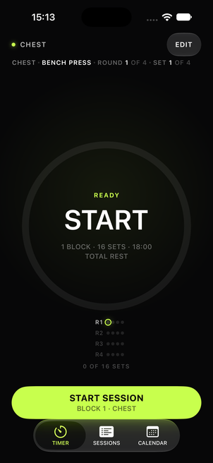
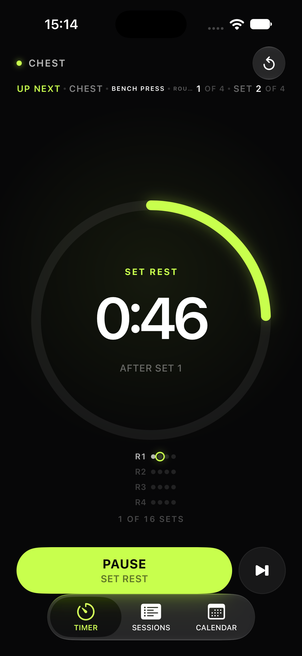
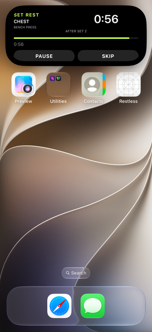
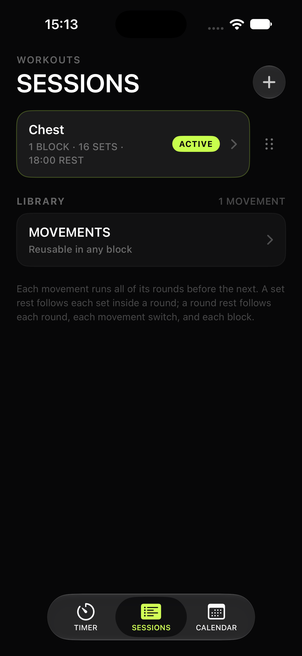
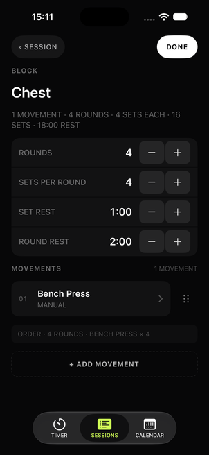
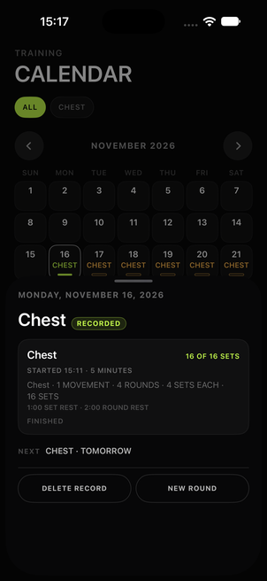
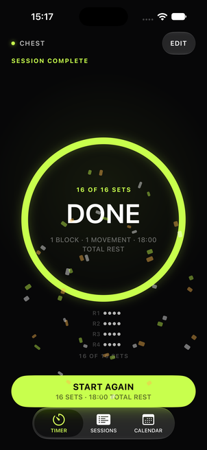

<div align="center">

# Restless

**A rest timer for strength training that lives on your Lock Screen.**


[Features](#features) • [How it works](#how-it-works) • [Getting started](#getting-started) • [Project layout](#project-layout) • [Development](#development)





</div>

Restless runs your workout as an ordered list of blocks: each movement works through all of its rounds before the next one starts, every set ends on a tap or a countdown, and the right rest follows automatically — set rest inside a round, round rest at every round, movement and block boundary. The whole session is mirrored on the Lock Screen and Dynamic Island, controllable from the Apple Watch, and projected onto a training calendar that keeps a read-only history of every run.

## Features

- **Structured sessions** — sessions are ordered blocks of library movements with rounds, sets per round, and separate set/round rests. The same movement can be timed in one block and manual in another.
- **Two ways to end a set** — tap SET DONE, or let a work countdown run out. Rests are chosen from the completed set's position, never from a counter, and the last set gets no rest.
- **Live Activity everywhere** — Lock Screen and Dynamic Island show the countdown, position and next set, with Pause/Skip controls. Time is stored as a deadline, so the display stays correct even when the app is suspended.
- **Apple Watch remote** — the wrist sends taps (set done, skip, pause) to the phone and renders the last published session. It never advances state on its own.
- **Training calendar** — the SESSIONS order projects onto a fixed cadence with rest days between rounds, dated or weekday exceptions, and per-day planning. Finished runs become read-only history records with their own plan snapshot.
- **Local-first editing** — stepper taps and keystrokes update the draft instantly; persistence coalesces after 350 ms of idle. Editing locks while a session is running.
- **One alert per deadline** — a single haptic in the foreground, a single local notification in the background, mirrored to the watch by iOS. No custom audio, no alarm spam.
- **Movement library** — name-only entries, reusable across blocks, managed from a dedicated screen. A movement in use cannot be deleted.

<details>
<summary>More screens</summary>

<div align="center">




</div>

</details>

## How it works

A session is an ordered list of blocks; a block holds rounds, sets per round, rests, and one or more movements. The order is always **movement → round → set**: each movement runs every round before the next movement starts.

| After the last set of… | Rest |
| --- | --- |
| A set, with more sets left in the round | Set rest (may be 0) |
| A round, with another round following | Round rest |
| A movement, with another movement following | Round rest |
| A block, with another block following | Round rest |
| The session | None — celebration |

Rounds and sets are unbounded integers (minimum 1); rests step by 15 s between 15 and 600 s. Every mutation — phone button, island link, watch tap, URL handler — goes through one transition function, `SessionTransitions.apply`, so a double tap can never consume two sets.

> [!NOTE]
> The app ships without App Groups (free developer account), so the widget cannot read the session store directly. Island controls are `Link`s to `restless://<action>` URLs applied by the app; `restless://restart` returns to the start gate.

## Getting started

You need a Mac with Xcode (Swift 6, strict concurrency), plus [XcodeGen](https://github.com/yonaskolb/XcodeGen) to generate the project:

```bash
brew install xcodegen swiftlint
npm install -g @fission-ai/openspec   # the pre-commit hook also validates specs
git config core.hooksPath .githooks   # once per clone: pre-commit lint + spec validation
xcodegen generate
```

Open `Restless.xcodeproj` and run the **Restless** scheme, or build from the terminal:

```bash
xcodebuild -project Restless.xcodeproj -scheme Restless \
  -destination 'platform=iOS Simulator,name=iPhone 18 Pro' \
  -derivedDataPath build build
```

> [!IMPORTANT]
> Set your own `DEVELOPMENT_TEAM` in `project.yml` before building for a device, then run `xcodegen generate` again. The project is generated — never edit `Restless.xcodeproj` by hand.

A fresh install seeds one session so every flow can be walked immediately. The iPhone app embeds the Live Activity extension and the watch app; the watch runs independently and pairs over WatchConnectivity.

## Project layout

| Path | Contents |
| --- | --- |
| `Shared/` | Pure model (Foundation + ActivityKit only): state machine, rest plan, calendar projection, theme, watch payload |
| `Restless/` | iPhone app — `App/`, `Session/` (engine, drafts), `Data/` (SwiftData), `Alerts/`, `UI/`, `Watch/` bridge |
| `RestlessWidget/` | Live Activity and Dynamic Island layouts |
| `RestlessWatch/` | watchOS remote: one screen plus the WatchConnectivity model |
| `RestlessTests/` | Swift Testing suites for transitions, rests, calendar, alerts, persistence and purity |
| `prototype-workout-timer.html` | Behaviour and visual reference the app is built against |
| `openspec/` | Spec-driven change proposals and the main specs |
| `tools/` | Prototype check server and drivers |
| `.argent/e2e/` | Replayable device-level e2e step lists |

## Development

The workflow is prototype-first: timing, copy, layout and colour changes land in `prototype-workout-timer.html` before the Swift code, and the rule set in `.agents/skills/restless-rest-timer/SKILL.md` stays in sync. Deadline maths, persistence, notifications and intents skip the prototype.

```bash
# Serve the prototype and dump the DOM after 6 s of virtual time
python3 tools/prototype-check.py [driver.js]

# Run the Swift Testing suites (keep exactly one simulator booted)
xcodebuild -project Restless.xcodeproj -scheme Restless \
  -destination 'platform=iOS Simulator,name=iPhone 18 Pro' \
  -derivedDataPath build test

# Lint and spec validation — both also run in the pre-commit hook
swiftlint lint --quiet --reporter summary
openspec validate --all --strict
```

Changes are planned as [OpenSpec](https://github.com/Fission-AI/OpenSpec) proposals under `openspec/changes/` before code is written; the `openspec-*` agent skills in `.agents/skills/` run the propose → apply → verify → archive workflow. Device-level UI flows are recorded and replayed with [Argent](https://github.com/software-mansion/argent) (`npm install` pulls it in); each e2e file's header states the fixture it assumes.

> [!TIP]
> Simulator state persists between runs. Do destructive checks on a throwaway simulator or restore the fixture afterwards, and return to the start gate any time with `restless://restart`.